<div align="center">

# TradeForge Frontend ⚡

**The React trading terminal for the TradeForge cryptocurrency platform.**

Track live markets, execute market/limit/stop-loss trades with AI risk insights, manage your fiat wallet, and monitor portfolio P&L from a fast, responsive single-page application.

[](https://react.dev/)
[](https://vite.dev/)
[](https://tailwindcss.com/)
[](https://redux-toolkit.js.org/)
[](https://ui.shadcn.com/)

</div>

---

## 📑 Table of Contents

- [Overview](#-overview)
- [Features](#-features)
- [Technology Stack](#-technology-stack)
- [Architecture](#-architecture)
- [Real-Time WebSocket Channels](#-real-time-websocket-channels)
- [Application Routes](#-application-routes)
- [Prerequisites](#-prerequisites)
- [Installation & Usage](#-installation--usage)
- [Configuration](#-configuration)
- [Available Scripts](#-available-scripts)
- [Project Structure](#-project-structure)
- [Related Repositories](#-related-repositories)

---

## 🔭 Overview

**TradeForge Frontend** is the client application for the [TradeForge backend](https://github.com/Biikash1/TradeForge). Built as a React 19 single-page application (SPA) powered by Vite and Redux Toolkit, it communicates with a Spring Boot REST API and STOMP WebSocket broker to deliver live cryptocurrency price feeds, advanced order execution, pre-trade AI risk analysis, fiat payment gateway integrations, and real-time trade notifications.

---

## 🚀 Features

| Feature | Description |
| :--- | :--- |
| **Secure Auth & Session Management** | Sign-up, sign-in, logout, password recovery UI, and 2FA OTP verification. Uses **in-memory JWT access tokens** paired with **HttpOnly refresh cookies** (`/auth/refresh`) and an Axios 401 interceptor queue for seamless silent token refreshes. |
| **Live Market Dashboard** | Real-time cryptocurrency prices via STOMP WebSockets, category filters (`All`, `Top 50`, `Top Gainers`, `Top Losers`), 24h price range progress bars, and interactive ApexCharts area charts (`1D`, `1W`, `1M`). |
| **Advanced Trading Terminal** | Place **MARKET**, **LIMIT**, and **STOP LOSS** buy/sell orders with real-time volume calculation and wallet/holdings validation. Includes a pre-trade **AI Risk Insight** review modal before order confirmation. |
| **Portfolio & Paginated Activity** | Portfolio analytics cards (Current Value, Total Invested, Net P&L, Top & Worst Performers), per-asset unrealized P&L tracking, and a paginated chronological order history with status badges (`FILLED`, `PENDING`, `CANCELLED`). |
| **Wallet & Transfers** | View USD fiat balances, copy Wallet IDs, browse paginated wallet transaction history, and send instant wallet-to-wallet transfers with custom notes. |
| **Fiat Deposits & Withdrawals** | Deposit flows integrating **Razorpay** (with live USD-to-INR estimate) and **Stripe**, complete with automatic callback verification. Manage multiple linked bank accounts (with IFSC validation) and track withdrawal settlement statuses. |
| **Watchlist & Coin Search** | Dedicated market search by coin name or symbol with market cap rankings, plus a synced Watchlist for quick asset tracking. |
| **AI Market Assistant** | Floating conversational AI chatbot (`/api/chat`) for real-time price, market volume, and market cap queries. |

---

## 🛠️ Technology Stack

| Layer | Technologies |
| :--- | :--- |
| **Framework & Routing** | React 19, React Router 7 |
| **Build & Linting** | Vite 8, ESLint 9 |
| **Styling & UI** | Tailwind CSS 4 (`@tailwindcss/vite`), shadcn/ui, Base UI, Radix UI Icons, Lucide Icons, `tw-animate-css`, Geist Variable Font |
| **State Management** | Redux Toolkit, React Redux, Redux Thunk |
| **Forms & Validation** | React Hook Form, Zod, `@hookform/resolvers`, `input-otp` |
| **Networking & Real-Time** | Axios (with JWT refresh interceptors), `@stomp/stompjs`, `sockjs-client` |
| **Data Visualization** | ApexCharts (`react-apexcharts`) |
| **Notifications** | Sonner, React Toastify |

---

## 🧭 Architecture

The application follows a unidirectional data flow: UI components dispatch asynchronous Redux thunks, the configured Axios client (`src/config/api.js`) attaches in-memory JWTs and handles automatic 401 token refreshes, and Redux reducers update the centralized store. Live market prices and trade alerts stream over STOMP WebSockets (`src/config/websocket.js`).

```mermaid
%% Generated by [https://gitdiagram.com/biikash1/tradeforge-frontend](https://gitdiagram.com/biikash1/tradeforge-frontend)
flowchart TD

subgraph group_app["Application shell"]
  node_app["App routes<br/>[App.jsx]"]
end

subgraph group_market["Markets and trading"]
  node_market_home["Market dashboard<br/>[Home.jsx]"]
  node_market_search["Coin search<br/>[SearchCoins.jsx]"]
  node_stock["Asset trading<br/>[TradingForm.jsx]"]
  node_watchlist["Watchlist<br/>[Watchlist.jsx]"]
end

subgraph group_account["Account and activity"]
  node_auth["Authentication<br/>[Auth.jsx]"]
  node_portfolio["Portfolio<br/>[Portfolio.jsx]"]
  node_activity["Order activity<br/>[Activity.jsx]"]
  node_wallet["Wallet<br/>[Wallet.jsx]"]
  node_payments["Fiat payments<br/>[PaymentDetails.jsx]"]
  node_withdrawal["Withdrawals<br/>[Withdrawal.jsx]"]
  node_profile["Profile & 2FA<br/>[Profile.jsx]"]
end

subgraph group_state["Client state and services"]
  node_coin_actions["Coin actions<br/>[ActionCoin.js]"]
  node_order_actions["Order actions<br/>[ActionOrder.js]"]
  node_wallet_actions["Wallet actions<br/>[ActionWallet.js]"]
  node_withdrawal_actions["Withdrawal actions<br/>[ActionWithdrawal.js]"]
  node_store[("Redux store<br/>[Store.js]")]
  node_api["API client<br/>[api.js]"]
  node_websocket["WebSocket client<br/>[websocket.js]"]
  node_chat["Chat service<br/>[chatService.js]"]
end

subgraph group_ui["Shared interface"]
  node_ui_components["UI components<br/>[components/ui]"]
end

node_user(("User"))
node_backend["TradeForge API"]

node_user -->|"uses"| node_app
node_app -->|"routes to"| node_auth
node_app -->|"routes to"| node_market_home
node_app -->|"routes to"| node_portfolio
node_app -->|"routes to"| node_activity
node_app -->|"routes to"| node_wallet
node_app -->|"routes to"| node_withdrawal
node_app -->|"routes to"| node_payments
node_app -->|"routes to"| node_watchlist
node_app -->|"routes to"| node_market_search
node_app -->|"routes to"| node_profile
node_app -->|"reads state"| node_store
node_app -->|"connects"| node_websocket
node_market_home -->|"dispatches"| node_coin_actions
node_market_search -->|"dispatches"| node_coin_actions
node_market_home -->|"subscribes"| node_websocket
node_market_home -->|"requests reply"| node_chat
node_market_home -.->|"opens trade"| node_stock
node_stock -->|"dispatches"| node_order_actions
node_stock -->|"dispatches"| node_wallet_actions
node_stock -->|"pre-trade insight"| node_chat
node_portfolio -->|"dispatches"| node_store
node_activity -->|"dispatches"| node_order_actions
node_watchlist -.->|"dispatches"| node_store
node_wallet -->|"dispatches"| node_wallet_actions
node_payments -->|"dispatches"| node_withdrawal_actions
node_withdrawal -->|"dispatches"| node_withdrawal_actions
node_coin_actions -->|"requests data"| node_api
node_order_actions -->|"requests data"| node_api
node_wallet_actions -->|"requests data"| node_api
node_withdrawal_actions -->|"requests data"| node_api
node_api -->|"REST requests"| node_backend
node_chat -->|"uses client"| node_api
node_coin_actions -.->|"updates state"| node_store
node_order_actions -.->|"updates state"| node_store
node_wallet_actions -.->|"updates state"| node_store
node_withdrawal_actions -.->|"updates state"| node_store
node_ui_components -->|"renders controls"| node_market_search
node_ui_components -->|"renders controls"| node_wallet

click node_app "[https://github.com/biikash1/tradeforge-frontend/blob/main/src/App.jsx](https://github.com/biikash1/tradeforge-frontend/blob/main/src/App.jsx)"
click node_auth "[https://github.com/biikash1/tradeforge-frontend/blob/main/src/pages/Auth/Auth.jsx](https://github.com/biikash1/tradeforge-frontend/blob/main/src/pages/Auth/Auth.jsx)"
click node_market_home "[https://github.com/biikash1/tradeforge-frontend/blob/main/src/pages/Home/Home.jsx](https://github.com/biikash1/tradeforge-frontend/blob/main/src/pages/Home/Home.jsx)"
click node_market_search "[https://github.com/biikash1/tradeforge-frontend/blob/main/src/pages/Search/SearchCoins.jsx](https://github.com/biikash1/tradeforge-frontend/blob/main/src/pages/Search/SearchCoins.jsx)"
click node_stock "[https://github.com/biikash1/tradeforge-frontend/blob/main/src/pages/Stock%20Details/TradingForm.jsx](https://github.com/biikash1/tradeforge-frontend/blob/main/src/pages/Stock%20Details/TradingForm.jsx)"
click node_portfolio "[https://github.com/biikash1/tradeforge-frontend/blob/main/src/pages/Portfolio/Portfolio.jsx](https://github.com/biikash1/tradeforge-frontend/blob/main/src/pages/Portfolio/Portfolio.jsx)"
click node_activity "[https://github.com/biikash1/tradeforge-frontend/blob/main/src/pages/Activity/Activity.jsx](https://github.com/biikash1/tradeforge-frontend/blob/main/src/pages/Activity/Activity.jsx)"
click node_watchlist "[https://github.com/biikash1/tradeforge-frontend/blob/main/src/pages/Watchlist/Watchlist.jsx](https://github.com/biikash1/tradeforge-frontend/blob/main/src/pages/Watchlist/Watchlist.jsx)"
click node_wallet "[https://github.com/biikash1/tradeforge-frontend/blob/main/src/pages/Wallet/Wallet.jsx](https://github.com/biikash1/tradeforge-frontend/blob/main/src/pages/Wallet/Wallet.jsx)"
click node_payments "[https://github.com/biikash1/tradeforge-frontend/blob/main/src/pages/Payment%20Details/PaymentDetails.jsx](https://github.com/biikash1/tradeforge-frontend/blob/main/src/pages/Payment%20Details/PaymentDetails.jsx)"
click node_withdrawal "[https://github.com/biikash1/tradeforge-frontend/blob/main/src/pages/Withdrawal/Withdrawal.jsx](https://github.com/biikash1/tradeforge-frontend/blob/main/src/pages/Withdrawal/Withdrawal.jsx)"
click node_profile "[https://github.com/biikash1/tradeforge-frontend/blob/main/src/pages/Profile/Profile.jsx](https://github.com/biikash1/tradeforge-frontend/blob/main/src/pages/Profile/Profile.jsx)"
click node_coin_actions "[https://github.com/biikash1/tradeforge-frontend/blob/main/src/State/Coin/ActionCoin.js](https://github.com/biikash1/tradeforge-frontend/blob/main/src/State/Coin/ActionCoin.js)"
click node_order_actions "[https://github.com/biikash1/tradeforge-frontend/blob/main/src/State/Order/ActionOrder.js](https://github.com/biikash1/tradeforge-frontend/blob/main/src/State/Order/ActionOrder.js)"
click node_wallet_actions "[https://github.com/biikash1/tradeforge-frontend/blob/main/src/State/Wallet/ActionWallet.js](https://github.com/biikash1/tradeforge-frontend/blob/main/src/State/Wallet/ActionWallet.js)"
click node_withdrawal_actions "[https://github.com/biikash1/tradeforge-frontend/blob/main/src/State/Withdrawal/ActionWithdrawal.js](https://github.com/biikash1/tradeforge-frontend/blob/main/src/State/Withdrawal/ActionWithdrawal.js)"
click node_store "[https://github.com/biikash1/tradeforge-frontend/blob/main/src/State/Store.js](https://github.com/biikash1/tradeforge-frontend/blob/main/src/State/Store.js)"
click node_api "[https://github.com/biikash1/tradeforge-frontend/blob/main/src/config/api.js](https://github.com/biikash1/tradeforge-frontend/blob/main/src/config/api.js)"
click node_websocket "[https://github.com/biikash1/tradeforge-frontend/blob/main/src/config/websocket.js](https://github.com/biikash1/tradeforge-frontend/blob/main/src/config/websocket.js)"
click node_chat "[https://github.com/biikash1/tradeforge-frontend/blob/main/src/services/chatService.js](https://github.com/biikash1/tradeforge-frontend/blob/main/src/services/chatService.js)"
click node_ui_components "[https://github.com/biikash1/tradeforge-frontend/blob/main/src/components/ui/button.jsx](https://github.com/biikash1/tradeforge-frontend/blob/main/src/components/ui/button.jsx)"

classDef toneBlue fill:#dbeafe,stroke:#2563eb,stroke-width:1.5px,color:#172554
classDef toneAmber fill:#fef3c7,stroke:#d97706,stroke-width:1.5px,color:#78350f
classDef toneMint fill:#dcfce7,stroke:#16a34a,stroke-width:1.5px,color:#14532d
classDef toneRose fill:#ffe4e6,stroke:#e11d48,stroke-width:1.5px,color:#881337
classDef toneIndigo fill:#e0e7ff,stroke:#4f46e5,stroke-width:1.5px,color:#312e81
class node_app,node_user toneBlue
class node_market_home,node_market_search,node_stock,node_watchlist toneAmber
class node_auth,node_portfolio,node_activity,node_wallet,node_payments,node_withdrawal,node_profile,node_backend toneMint
class node_coin_actions,node_order_actions,node_wallet_actions,node_withdrawal_actions,node_store,node_api,node_websocket,node_chat toneRose
class node_ui_components toneIndigo
```



---

## 📡 Real-Time WebSocket Channels

The STOMP client (`src/config/websocket.js`) connects to `ws://localhost:8080/ws` with automatic 5-second reconnect and pending-subscription queueing:

| Channel | Scope | Purpose |
| :--- | :--- | :--- |
| `/topic/public/prices` | `Home.jsx` | Global live price updates for the market dashboard |
| `/topic/price/{coinId}` | `StockDetails.jsx` | Granular live price stream for the active asset page |
| `/topic/notifications/{userId}` | `App.jsx` | Real-time user trade execution and status toast alerts |

---

## 🗺️ Application Routes

| Route | View | Description |
| :--- | :--- | :--- |
| `/` | `Home` | Live market table, interactive chart, coin metrics, and floating AI Assistant |
| `/market/:id` | `StockDetails` | Detailed asset metrics, price chart, watchlist toggle, and trading terminal |
| `/portfolio` | `Portfolio` | Portfolio analytics (Net P&L, top/worst performers) and holdings table |
| `/activity` | `Activity` | Paginated order history with execution/target prices and status badges |
| `/wallet` | `Wallet` | Fiat USD balance, Razorpay/Stripe deposits, transfers, and transaction history |
| `/payment-details` | `PaymentDetails` | Linked bank accounts management for withdrawal settlements |
| `/withdrawal` | `Withdrawal` | Withdrawal request history and settlement statuses |
| `/watchlist` | `Watchlist` | Saved cryptocurrency watchlist |
| `/search` | `SearchCoins` | Search markets by coin name or ticker symbol |
| `/profile` | `Profile` | User account information and 2-Step Verification settings |
| `/signin`, `/signup`, `/forgot-password` | `Auth` | Unauthenticated user onboarding and login views |

---

## ⚙️ Prerequisites

Before you begin, ensure you have the following installed on your machine:

- **Node.js**: v20.19+ or v22.12+ (required by Vite)
- **npm**: v10+
- **Backend API**: The [TradeForge Backend](https://github.com/Biikash1/TradeForge) running locally (default: `http://localhost:8080`)

---

## 💻 Installation & Usage

**1. Clone the repository**

```bash
git clone [https://github.com/Biikash1/TradeForge-Frontend.git](https://github.com/Biikash1/TradeForge-Frontend.git)
cd TradeForge-Frontend
```

**2. Install dependencies**

```bash
npm install
```

**3. Setup environment variables**

Create a `.env.local` file in the root directory (git-ignored):

```bash
touch .env.local
```

Add your backend API base URL (see [Configuration](#-configuration) below).

**4. Start the development server**

```bash
npm run dev
```

The application will be available at `http://localhost:5173`.

> **Note:** Start the Spring Boot backend first so REST requests, HttpOnly refresh cookies, and WebSocket streams connect properly.

---

## 🔧 Configuration

Vite exposes environment variables prefixed with `VITE_`. Define these in `.env.local`:

```env
VITE_API_BASE_URL=http://localhost:8080
```

| Variable | Description | Default |
| :--- | :--- | :--- |
| `VITE_API_BASE_URL` | Base URL of the TradeForge backend REST API | `http://localhost:8080` |

> ⚠️ **Security Warning:** Only store public configuration values here. Variables prefixed with `VITE_` are bundled into the client build—never place secret keys (Stripe/Razorpay secrets, JWT signing keys, etc.) in the frontend.

---

## 📜 Available Scripts

| Command | Description |
| :--- | :--- |
| `npm run dev` | Starts the local Vite development server with HMR |
| `npm run build` | Builds the production bundle into `dist/` |
| `npm run preview` | Serves the production build locally for verification |
| `npm run lint` | Runs ESLint across the codebase |

---

## 📁 Project Structure

```plaintext
biikash1-tradeforge-frontend/
├── public/                     # Static assets (favicons, etc.)
├── src/
│   ├── assets/                 # Images and static media
│   ├── components/ui/          # Reusable shadcn/ui, Base UI & Radix primitives
│   ├── config/
│   │   ├── api.js              # Axios instance, in-memory JWT & 401 refresh queue
│   │   └── websocket.js        # STOMP WebSocket client & subscription manager
│   ├── lib/
│   │   └── utils.js            # Tailwind class-merging utility (`cn`)
│   ├── pages/
│   │   ├── Activity/           # Paginated order history table
│   │   ├── Admin/              # Admin withdrawal view
│   │   ├── Auth/               # Sign-in, sign-up, and forgot-password forms
│   │   ├── Home/               # Market dashboard, asset table, charts, AI chatbot
│   │   ├── Navbar/             # Top navigation bar and slide-out sidebar
│   │   ├── NotFound/           # 404 fallback page
│   │   ├── Payment Details/    # Linked bank accounts & form validation
│   │   ├── Portfolio/          # Holdings table & P&L analytics dashboard
│   │   ├── Profile/            # User profile & 2FA OTP verification dialog
│   │   ├── Search/             # Coin search interface
│   │   ├── Stock Details/      # Coin details, trading form & AI risk insight modal
│   │   ├── Wallet/             # Balance, top-ups (Razorpay/Stripe), transfers, withdrawals
│   │   ├── Watchlist/          # User watchlist table
│   │   └── Withdrawal/         # Withdrawal settlement history
│   ├── services/
│   │   └── chatService.js      # AI market chatbot & pre-trade risk insight API calls
│   ├── State/                  # Redux Toolkit store, actions, types, and reducers
│   │   ├── Assets/
│   │   ├── Authentication/
│   │   ├── Coin/
│   │   ├── Order/
│   │   ├── Portfolio/
│   │   ├── Wallet/
│   │   ├── Watchlist/
│   │   ├── Withdrawal/
│   │   └── Store.js
│   ├── utils/                  # Profit calculation & watchlist lookup helpers
│   ├── App.jsx                 # Route definitions, session bootstrap & WebSocket alerts
│   ├── index.css               # Tailwind CSS 4 theme tokens & dark mode variables
│   └── main.jsx                # React root, BrowserRouter & Redux Provider
├── components.json             # shadcn/ui configuration
├── eslint.config.js            # ESLint flat config
├── index.html                  # Vite HTML entry point
├── jsconfig.json               # Path alias resolution (`@/*`)
├── package.json                # Dependencies and scripts
└── vite.config.js              # Vite plugins and path aliases
```

---

## 🔗 Related Repositories

| Repository | Description |
| :--- | :--- |
| **[TradeForge Backend](https://github.com/Biikash1/TradeForge)** | The Spring Boot backend handling REST APIs, JWT/HttpOnly cookie auth, 2FA, the trading engine, STOMP WebSockets, AI insights, and payment gateways. |
| **[TradeForge Frontend](https://github.com/Biikash1/TradeForge-Frontend)** | This repository — the React 19 trading terminal client. |