<div align="center">

# TradeForge Frontend ⚡

**The React trading terminal for the TradeForge cryptocurrency platform.**

Track live markets, place trades, manage your wallet, and top up with fiat, all from a fast, responsive single-page app.

[](https://react.dev/)
[](https://vite.dev/)
[](https://tailwindcss.com/)
[](https://redux-toolkit.js.org/)
[](https://ui.shadcn.com/)

</div>

---

## 📑 Table of Contents

- [Overview](#-overview)
- [Features](#-features)
- [Technology Stack](#-technology-stack)
- [Architecture](#-architecture)
- [Prerequisites](#-prerequisites)
- [Installation & Usage](#-installation--usage)
- [Configuration](#-configuration)
- [Project Structure](#-project-structure)
- [Related Repositories](#-related-repositories)

---

## 🔭 Overview

**TradeForge Frontend** is the client application for the [TradeForge backend](https://github.com/Biikash1/TradeForge). Built as a high-performance React single-page application (SPA), it seamlessly communicates with a Spring Boot REST API. It delivers a comprehensive cryptocurrency trading experience, featuring real-time market data via WebSockets, AI-powered trade insights, fiat wallet management, and secure two-factor authentication (2FA).

---

## 🚀 Features

| Feature | Description |
| :--- | :--- |
| **Authentication & 2FA** | Secure sign-up, sign-in, and password recovery, featuring OTP-based Two-Factor Authentication via email. |
| **Live Market Dashboard** | Real-time cryptocurrency prices powered by WebSockets, market cap rankings, and interactive historical price charts using ApexCharts. |
| **Advanced Trading Terminal** | Execute MARKET, LIMIT, and STOP LOSS orders. Includes a pre-trade **AI Risk Insight** integration to analyze trade parameters. |
| **Portfolio & Activity** | Track current holdings, analyze unrealized P&L, identify top/worst performers, and view detailed chronological order history. |
| **Wallet Management** | View fiat balances, track transaction history, and easily transfer funds between user wallets. |
| **Fiat Payments & Withdrawals** | Deposit flows integrating **Razorpay** and **Stripe**. Manage verified bank accounts for seamless withdrawals. |
| **AI Market Assistant** | Floating conversational AI chatbot capable of answering market queries and summarizing volume/cap trends. |

---

## 🛠️ Technology Stack

| Layer | Technologies |
| :--- | :--- |
| **Framework** | React 19, React Router 7 |
| **Build Tooling** | Vite, ESLint |
| **Styling & UI** | Tailwind CSS 4, shadcn/ui, Radix UI, Base UI, Lucide Icons, `tw-animate-css`, Geist Font |
| **State Management** | Redux Toolkit, React Redux, Redux Thunk |
| **Forms & Validation** | React Hook Form, Zod, `input-otp` |
| **Data Fetching & APIs** | Axios (with interceptors for JWT refresh), `@stomp/stompjs` (WebSockets) |
| **Charting** | ApexCharts (`react-apexcharts`) |
| **Notifications** | Sonner, React Toastify |

---

## 🧭 Architecture

The application follows a strict unidirectional data flow. The UI dispatches asynchronous actions, Redux Toolkit handles state mutations, and a configured Axios client communicates with the backend API. Real-time updates (prices, notifications) are handled via STOMP over WebSockets.

```mermaid
%% Generated by [https://gitdiagram.com/biikash1/tradeforge-frontend](https://gitdiagram.com/biikash1/tradeforge-frontend)
flowchart TD

subgraph group_app["Application shell"]
  node_app["App routes<br/>[App.jsx]"]
end

subgraph group_market["Markets and trading"]
  node_market_home["Market dashboard<br/>[Home.jsx]"]
  node_market_search["Coin search<br/>[SearchCoins.jsx]"]
  node_stock["Asset trading<br/>[TradingForm.jsx]"]
  node_watchlist["Watchlist<br/>[Watchlist.jsx]"]
end

subgraph group_account["Account and activity"]
  node_auth["Authentication<br/>[Auth.jsx]"]
  node_portfolio["Portfolio<br/>[Portfolio.jsx]"]
  node_activity["Order activity<br/>[Activity.jsx]"]
  node_wallet["Wallet<br/>[Wallet.jsx]"]
  node_payments["Fiat payments<br/>[PaymentDetails.jsx]"]
  node_withdrawal["Withdrawals<br/>[Withdrawal.jsx]"]
  node_withdrawal_admin["Withdrawal admin"]
end

subgraph group_state["Client state and services"]
  node_coin_actions["Coin actions<br/>[ActionCoin.js]"]
  node_order_actions["Order actions<br/>[ActionOrder.js]"]
  node_wallet_actions["Wallet actions<br/>[ActionWallet.js]"]
  node_withdrawal_actions["Withdrawal actions"]
  node_store[("Redux store<br/>[Store.js]")]
  node_api["API client<br/>[api.js]"]
  node_websocket["WebSocket client<br/>[websocket.js]"]
  node_chat["Chat service<br/>[chatService.js]"]
end

subgraph group_ui["Shared interface"]
  node_ui_components["UI components<br/>[button.jsx]"]
end

node_user(("User"))
node_backend["TradeForge API"]

node_user -->|"uses"| node_app
node_app -->|"routes to"| node_auth
node_app -->|"routes to"| node_market_home
node_app -->|"routes to"| node_portfolio
node_app -->|"routes to"| node_activity
node_app -->|"routes to"| node_wallet
node_app -->|"routes to"| node_withdrawal
node_app -->|"routes to"| node_payments
node_app -->|"routes to"| node_watchlist
node_app -->|"routes to"| node_market_search
node_app -.->|"routes to"| node_withdrawal_admin
node_app -->|"reads state"| node_store
node_app -->|"connects"| node_websocket
node_market_home -->|"dispatches"| node_coin_actions
node_market_search -->|"dispatches"| node_coin_actions
node_market_home -->|"subscribes"| node_websocket
node_market_home -->|"requests reply"| node_chat
node_market_home -.->|"opens trade"| node_stock
node_stock -->|"dispatches"| node_order_actions
node_stock -->|"dispatches"| node_wallet_actions
node_portfolio -->|"dispatches"| node_store
node_activity -->|"dispatches"| node_order_actions
node_watchlist -.->|"dispatches"| node_store
node_wallet -->|"dispatches"| node_wallet_actions
node_payments -->|"dispatches"| node_withdrawal_actions
node_withdrawal -->|"dispatches"| node_withdrawal_actions
node_withdrawal_admin -.->|"dispatches"| node_withdrawal_actions
node_coin_actions -->|"requests data"| node_api
node_order_actions -->|"requests data"| node_api
node_wallet_actions -->|"requests data"| node_api
node_withdrawal_actions -->|"requests data"| node_api
node_api -->|"REST requests"| node_backend
node_chat -->|"uses client"| node_api
node_coin_actions -.->|"updates state"| node_store
node_order_actions -.->|"updates state"| node_store
node_wallet_actions -.->|"updates state"| node_store
node_withdrawal_actions -.->|"updates state"| node_store
node_ui_components -->|"renders controls"| node_market_search
node_ui_components -->|"renders controls"| node_wallet

click node_app "[https://github.com/biikash1/tradeforge-frontend/blob/main/src/App.jsx](https://github.com/biikash1/tradeforge-frontend/blob/main/src/App.jsx)"
click node_auth "[https://github.com/biikash1/tradeforge-frontend/blob/main/src/pages/Auth/Auth.jsx](https://github.com/biikash1/tradeforge-frontend/blob/main/src/pages/Auth/Auth.jsx)"
click node_market_home "[https://github.com/biikash1/tradeforge-frontend/blob/main/src/pages/Home/Home.jsx](https://github.com/biikash1/tradeforge-frontend/blob/main/src/pages/Home/Home.jsx)"
click node_market_search "[https://github.com/biikash1/tradeforge-frontend/blob/main/src/pages/Search/SearchCoins.jsx](https://github.com/biikash1/tradeforge-frontend/blob/main/src/pages/Search/SearchCoins.jsx)"
click node_stock "[https://github.com/biikash1/tradeforge-frontend/blob/main/src/pages/Stock%20Details/TradingForm.jsx](https://github.com/biikash1/tradeforge-frontend/blob/main/src/pages/Stock%20Details/TradingForm.jsx)"
click node_portfolio "[https://github.com/biikash1/tradeforge-frontend/blob/main/src/pages/Portfolio/Portfolio.jsx](https://github.com/biikash1/tradeforge-frontend/blob/main/src/pages/Portfolio/Portfolio.jsx)"
click node_activity "[https://github.com/biikash1/tradeforge-frontend/blob/main/src/pages/Activity/Activity.jsx](https://github.com/biikash1/tradeforge-frontend/blob/main/src/pages/Activity/Activity.jsx)"
click node_watchlist "[https://github.com/biikash1/tradeforge-frontend/blob/main/src/pages/Watchlist/Watchlist.jsx](https://github.com/biikash1/tradeforge-frontend/blob/main/src/pages/Watchlist/Watchlist.jsx)"
click node_wallet "[https://github.com/biikash1/tradeforge-frontend/blob/main/src/pages/Wallet/Wallet.jsx](https://github.com/biikash1/tradeforge-frontend/blob/main/src/pages/Wallet/Wallet.jsx)"
click node_payments "[https://github.com/biikash1/tradeforge-frontend/blob/main/src/pages/Payment%20Details/PaymentDetails.jsx](https://github.com/biikash1/tradeforge-frontend/blob/main/src/pages/Payment%20Details/PaymentDetails.jsx)"
click node_withdrawal "[https://github.com/biikash1/tradeforge-frontend/blob/main/src/pages/Withdrawal/Withdrawal.jsx](https://github.com/biikash1/tradeforge-frontend/blob/main/src/pages/Withdrawal/Withdrawal.jsx)"
click node_withdrawal_admin "[https://github.com/biikash1/tradeforge-frontend/blob/main/src/pages/Admin/WithdrawalAdmin.jsx](https://github.com/biikash1/tradeforge-frontend/blob/main/src/pages/Admin/WithdrawalAdmin.jsx)"
click node_coin_actions "[https://github.com/biikash1/tradeforge-frontend/blob/main/src/State/Coin/ActionCoin.js](https://github.com/biikash1/tradeforge-frontend/blob/main/src/State/Coin/ActionCoin.js)"
click node_order_actions "[https://github.com/biikash1/tradeforge-frontend/blob/main/src/State/Order/ActionOrder.js](https://github.com/biikash1/tradeforge-frontend/blob/main/src/State/Order/ActionOrder.js)"
click node_wallet_actions "[https://github.com/biikash1/tradeforge-frontend/blob/main/src/State/Wallet/ActionWallet.js](https://github.com/biikash1/tradeforge-frontend/blob/main/src/State/Wallet/ActionWallet.js)"
click node_withdrawal_actions "[https://github.com/biikash1/tradeforge-frontend/blob/main/src/State/Withdrawal/ActionWithdrawal.js](https://github.com/biikash1/tradeforge-frontend/blob/main/src/State/Withdrawal/ActionWithdrawal.js)"
click node_store "[https://github.com/biikash1/tradeforge-frontend/blob/main/src/State/Store.js](https://github.com/biikash1/tradeforge-frontend/blob/main/src/State/Store.js)"
click node_api "[https://github.com/biikash1/tradeforge-frontend/blob/main/src/config/api.js](https://github.com/biikash1/tradeforge-frontend/blob/main/src/config/api.js)"
click node_websocket "[https://github.com/biikash1/tradeforge-frontend/blob/main/src/config/websocket.js](https://github.com/biikash1/tradeforge-frontend/blob/main/src/config/websocket.js)"
click node_chat "[https://github.com/biikash1/tradeforge-frontend/blob/main/src/services/chatService.js](https://github.com/biikash1/tradeforge-frontend/blob/main/src/services/chatService.js)"
click node_ui_components "[https://github.com/biikash1/tradeforge-frontend/blob/main/src/components/ui/button.jsx](https://github.com/biikash1/tradeforge-frontend/blob/main/src/components/ui/button.jsx)"

classDef toneNeutral fill:#f8fafc,stroke:#334155,stroke-width:1.5px,color:#0f172a
classDef toneBlue fill:#dbeafe,stroke:#2563eb,stroke-width:1.5px,color:#172554
classDef toneAmber fill:#fef3c7,stroke:#d97706,stroke-width:1.5px,color:#78350f
classDef toneMint fill:#dcfce7,stroke:#16a34a,stroke-width:1.5px,color:#14532d
classDef toneRose fill:#ffe4e6,stroke:#e11d48,stroke-width:1.5px,color:#881337
classDef toneIndigo fill:#e0e7ff,stroke:#4f46e5,stroke-width:1.5px,color:#312e81
classDef toneTeal fill:#ccfbf1,stroke:#0f766e,stroke-width:1.5px,color:#134e4a
class node_app,node_user toneBlue
class node_market_home,node_market_search,node_stock,node_watchlist toneAmber
class node_auth,node_portfolio,node_activity,node_wallet,node_payments,node_withdrawal,node_withdrawal_admin,node_backend toneMint
class node_coin_actions,node_order_actions,node_wallet_actions,node_withdrawal_actions,node_store,node_api,node_websocket,node_chat toneRose
class node_ui_components toneIndigo
```



---

## ⚙️ Prerequisites

Before you begin, ensure you have the following installed on your machine:

* **Node.js**: v20.19+ or v22.12+ (required by Vite)
* **npm**: v10+
* **Backend API**: The TradeForge Backend must be running locally (default: `http://localhost:8080`).

## 💻 Installation & Usage

**1. Clone the repository**

```bash
git clone https://github.com/Biikash1/TradeForge-Frontend.git
cd TradeForge-Frontend
```

**2. Install dependencies**

```bash
npm install
```

**3. Setup Environment Variables**
Create a `.env.local` file in the root directory (this file is git-ignored):

```bash
touch .env.local
```

*Add your backend API URL (see the Configuration section below).*

**4. Start the development server**

```bash
npm run dev
```

The application will be available at `http://localhost:5173`.

> **Note:** Ensure the Spring Boot backend is running first so that API calls and WebSocket connections succeed.

## 🔧 Configuration

Vite exposes environment variables prefixed with `VITE_`. Define these in your `.env.local` file:

```env
VITE_API_BASE_URL=http://localhost:8080
```

| Variable | Description | Default | 
| ----- | ----- | ----- | 
| `VITE_API_BASE_URL` | Base URL of the TradeForge backend REST API | `http://localhost:8080` | 

> ⚠️ **Security Warning:** Only store public configuration values here. Anything prefixed with `VITE_` is bundled into the client build. Never store secret keys (e.g., Stripe/Razorpay private keys or JWT secrets) in the frontend.

## 📁 Project Structure

```plaintext
biikash1-tradeforge-frontend/
├── public/                 # Static assets (favicons, etc.)
├── src/
│   ├── assets/             # Images and static media
│   ├── components/ui/      # Reusable shadcn/ui and Radix components
│   ├── config/             # Axios interceptor setup & WebSocket (STOMP) config
│   ├── lib/                # Utility functions (e.g., tailwind `cn` merger)
│   ├── pages/              # Application views/routes
│   │   ├── Activity/       # Order history table
│   │   ├── Auth/           # Login, Registration, Password Reset
│   │   ├── Home/           # Market dashboard, Asset lists, AI Chatbot
│   │   ├── Portfolio/      # Holdings, P&L analytics
│   │   ├── Stock Details/  # Advanced Trading Form, Charts, AI Risk Insight
│   │   ├── Wallet/         # Fiat balance, Top-ups (Stripe/Razorpay), Transfers
│   │   └── ...             # Profile, Watchlist, Payment Details, Search
│   ├── services/           # External service handlers (e.g., AI Chat endpoints)
│   ├── State/              # Redux Store, Actions, Types, and Reducers
│   │   ├── Assets/
│   │   ├── Authentication/
│   │   ├── Coin/
│   │   ├── Order/
│   │   ├── Portfolio/
│   │   ├── Wallet/
│   │   ├── Watchlist/
│   │   └── Withdrawal/
│   ├── utils/              # Helper functions (profit calculation, watchlist checks)
│   ├── App.jsx             # Main router and global WebSocket subscriptions
│   └── main.jsx            # React root and Redux provider wrapper
├── index.html              # Vite entry HTML
├── vite.config.js          # Vite configuration & path aliases
└── package.json            # Dependencies and scripts
```

## 🔗 Related Repositories

| Repository | Description |
| :--- | :--- |
| **[TradeForge Backend](#)** | The Spring Boot backend. Handles REST APIs, JWT authentication, 2FA security, the core trading engine, WebSockets, and third-party payment integrations. |
| **[TradeForge Frontend](#)** | This repository. The React client application. |